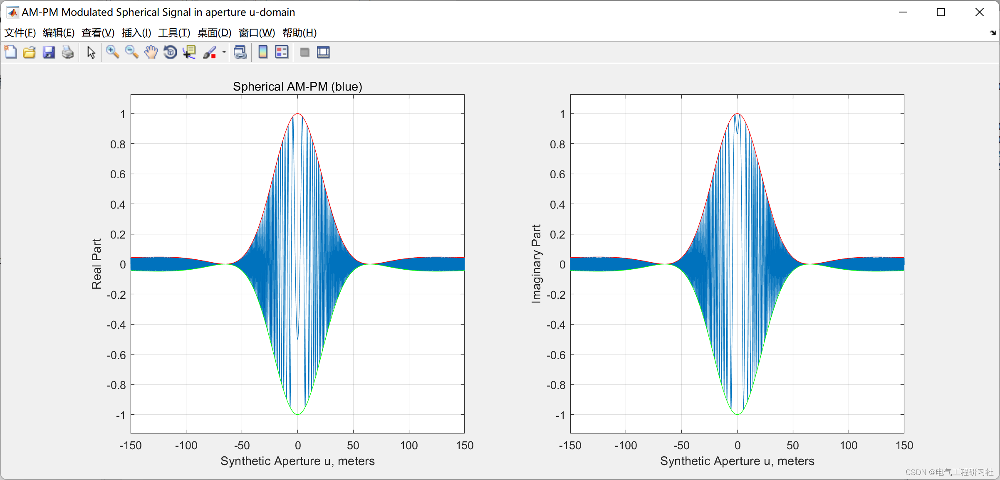
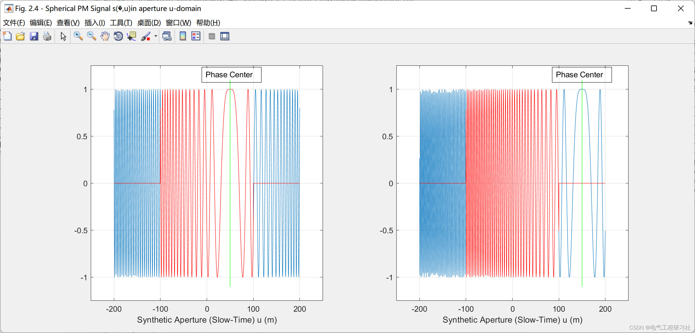
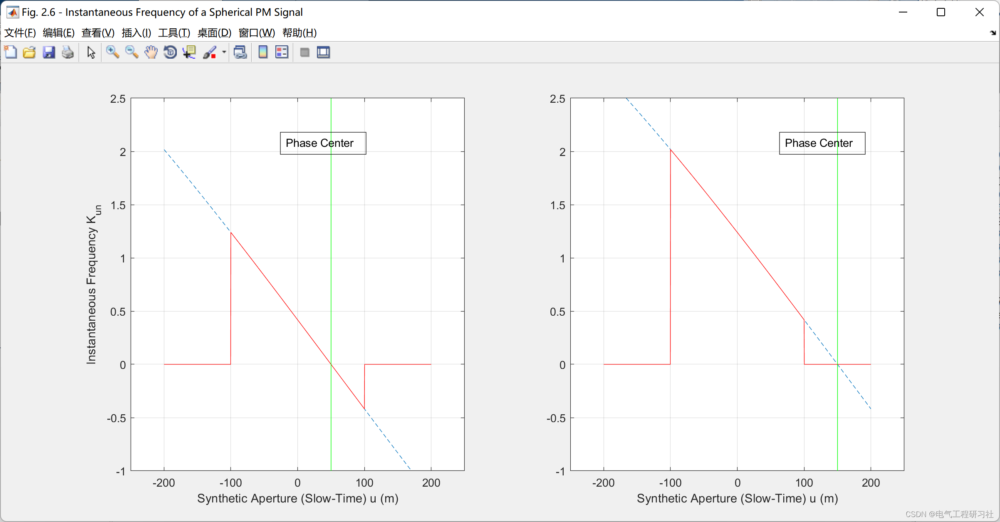
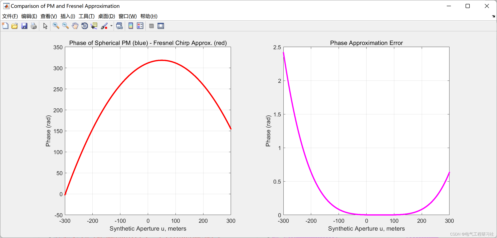
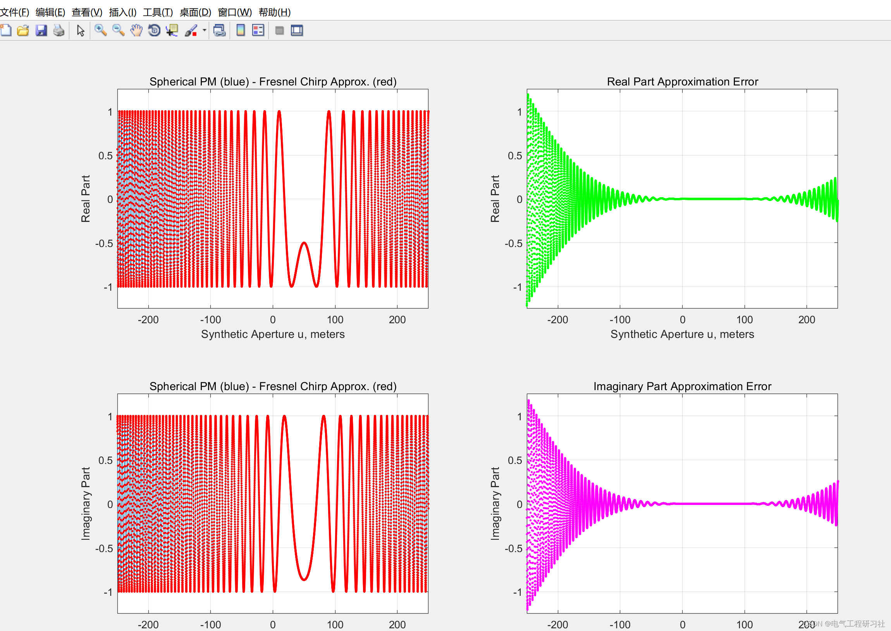

# Signal Processing - Adaptive Algorithm-based SAR Signal Processing (Matlab Code Implementation)

1. Overview of the paper includes:
- Separation and modularization of four target air reconstruction algorithms: 2D matching filter (wavefront reconstruction), time domain correlation (TDC), back projection (BP), and range stacking (RS).
- Replacing outdated graphics commands with modern rendering commands to clearly show the impact of DSP operations on SAR signals.
- Removing cumbersome code, performing 2D interpolation in the (kx, ky) domain for unevenly distributed data and replacing it with more concise and elegant modern MatLab commands.
- Assigning descriptive names to important SAR signals according to book symbols and naming conventions as much as possible. Additionally, I have provided detailed tables for all SAR signals and their domains.
- Adding several scripts to calculate the CTFT of AM-PM and PM spherical SAR signals both in digital form and using the steady-state phase approximation (SPA) method.
- A few minor code improvements.
2. Run results here are only a part of the results:
- Edit
- Edit
- Edit
- Edit
- Edit
%% Fresnel Approximation of a PM Signal by a Chirp Signal\n\n%% Workspace Initialization.\nclc; clear; close all;\n\n%% Radar System Parameters       \nc  = 3e8;            % propagation speed\nfc = 250e6;          % frequency\nlambda = c/fc;       % Wavelength\nk = 2*pi/lambda;     % Wavenumber\nXc = 2e3;            % Range distance to center of target area\n\n%% Case 1: Broadside Target Area\nL  = 300;             % synthetic aperture is 2*L\nY0 = 100;             % target area in cross-range is within [Yc-Y0,Yc+Y0]\nYc = 0;               % Cross-range distance to center of target area\ndu = 0.05;\nu = -L:du:L;\nxn = Xc;\nyn = 50;\n\n%% Signal Definitions - Fresnel Approximation \n% $$\exp[-j2k \sqrt{x_n^2 + (y_n - u)^2}] \approx \exp\Bigg[-j2kx_n -\n% j\frac{k(y_n - u)^2}{X_c}\Bigg]$$\n\n%%%%%%%%%%%%%%%%%%%%%%%%%%%%%%%%%%%%%%%%%%%%%%%%%%%%%%%%%%$%\n%   Program to compare between the original PM signal and  %\n%   Fresnel Approximation                                  %\n%%%%%%%%%%%%%%%%%%%%%%%%%%%%%%%%%%%%%%%%%%%%%%%%%%%%%%%%%%$%\n\n% Original Spherical PM Signal:\nPM = exp(-1i*2*k*sqrt(xn^2+(yn-u).^2));\n\n% Fresnel Chirp Approximation:\nFA = exp(-1i*2*k*(xn+((yn-u).^2)/Xc/2));\n\n%% Plot the Spherical PM and Chirp Approximation Signals.\nh1 = figure('NumberTitle', 'off','Name','Comparison of PM and Fresnel Approximation', ...\n            'Position', [100 0 1200 1000]);\n\nsubplot(2,2,1)\nplot(u,real(PM))\ntitle('Spherical PM (blue) - Fresnel Chirp Approx. (red)')\nhold on;\nplot(u,real(FA),'r.')\nxlabel('Synthetic Aperture u, meters')\nylabel('Real Part')\naxis([-250 250 1.25*min(real(PM)) 1.25*max(real(PM))]);\ngrid on;\n\nsubplot(2,2,2)\nplot(u,real(PM) - real(FA),'g.')\nxlabel('Synthetic Aperture u, meters')\nylabel('Real Part')\ntitle('Real Part Approximation Error')\ngrid on;\naxis([-250 250 1.25*min(real(PM)) 1.25*max(real(PM))]);\ngrid on;\n\nsubplot(2,2,3)\nplot(u,imag(PM))\nhold on;\nplot(u,imag(FA),'r.')\ntitle('Spherical PM (blue) - Fresnel Chirp Approx. (red)')\nxlabel('Synthetic Aperture u, meters')\nylabel('Imaginary Part')\naxis([-250 250 1.25*min(imag(FA)) 1.25*max(imag(FA))]);\ngrid on;\n\nsubplot(2,2,4)\nplot(u,imag(PM) - imag(FA),'m.')\nxlabel('Synthetic Aperture u, meters')\nylabel('Imaginary Part')\ntitle('Imaginary Part Approximation Error')\ngrid on;\naxis([-250 250 1.25*min(imag(FA)) 1.25*max(imag(FA))]);\ngrid on;\n\n%% Phase Comparison\nh2 = figure('NumberTitle', 'off','Name','Comparison of PM and Fresnel Approximation', ...\n            'Position', [100 0 1200 500]);\n\nsubplot(1,2,1)\nplot(u,unwrap(angle(PM)))\nhold on;\nplot(u,unwrap(angle(FA)),'r.')\ntitle('Phase of Spherical PM (blue) - Fresnel Chirp Approx. (red)')\nxlabel('Synthetic Aperture u, meters')\nylabel('Phase (rad)')\ngrid on;\n\nsubplot(1,2,2)\nplot(u,unwrap(angle(PM)) - unwrap(angle(FA)),'m.')\nxlabel('Synthetic Aperture u, meters')\nylabel('Phase (rad)')\ntitle('Phase Approximation Error')\ngrid on;\n  
4. Conclusion

## Images

<!-- PAYMENT_BLOCK -->

## Get this dataset

- Payment link (Stripe): [Buy now](https://buy.stripe.com/3cs8yP7sY87d0vu9AB)
- Payment QR code: 

<!-- /PAYMENT_BLOCK -->
